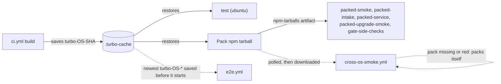

# Workflows

The workflow files here are more surface than one operator can hold in their head,
and the dangerous subset is small. This file names that subset. Tracked in #301
(review-lane rollout); the ruling that asked for it is
`fable-ruling-4-ci-surface.md`.

## The merge gate

Two checks are required on `main` by ruleset `18441175`, plus one native rule.
Nothing else blocks a merge, however red it looks:

The ruleset is the authority, and it is edited directly through the GitHub API
(`gh api repos/prismalens/prismalens/rulesets/18441175`). There is deliberately no
in-tree file that declares it: a declarative copy with nothing to reconcile it
cannot be kept current, and a stale one reads as authority. This table, and the
live ruleset, are what to trust.

| Required check | Published by | Kind |
| --- | --- | --- |
| `CI gate` | `ci.yml` → job `ci-gate` | check run |
| `Validate PR title (conventional commits)` | `pr-title.yml` → job `validate` (single check run; step-level event split) | check run |

Both required contexts also report on `merge_group` events (#403): the merge
queue validates each PR against a speculative merge onto `main`, which is what
replaces the ruleset's "branch must be up to date" requirement and its
full-CI-rerun-per-sibling-merge cost.

The third blocker is not a check at all: `required_review_thread_resolution: true`
on the same ruleset. An unresolved review thread blocks the merge button natively,
with no workflow, token or status in the path.

## `ci.yml` jobs: model kind, cadence, required

A red `CI gate` should mean the code is wrong, never that a free model was slow,
renamed or refused (#884). Live-model jobs are advisory and leave the gate.

| Job | Model | Cadence | Required |
| --- | --- | --- | --- |
| `build`, `lint`, `pack`, `packed-smoke` | none | every PR | yes |
| `test` | scripted fake agent | every PR on ubuntu, with the coverage floors (#58); macOS also on `merge_group` and pushes to `main` | yes |
| `packed-intake` | scripted fake ACP agent (`PACKED_INTAKE_AGENT=fake`) | every PR | no, until three recorded greens |
| `packed-service` | none | every PR | no |
| `packed-upgrade-smoke`, `gate-side-checks` | scripted fake ACP agent, on the packed tarball | every PR | no, until three recorded greens |
| `harness-admission` (OpenCode and Claude Code legs) | scripted model server on loopback (`scripts/fakes/fake-model-server.mjs`), the real pinned agent; R1-R7, 3 runs that must agree | every PR | yes |

One build per run (#885): `build` saves turbo's cache (`TURBO_CACHE_DIR`, `.turbo-cache`) under
`turbo-<os>-<sha>`; `test` (ubuntu) and `pack` need it and restore it, so their `pnpm build` replays.
`e2e.yml` starts beside `ci.yml`, so it restores the newest cache saved before it gets there.
`cross-os-smoke.yml` waits for `Pack npm tarball` on the same commit and installs that artifact,
packing itself only if that job is missing or red.

## `e2e.yml`: sharded, with a quarantine

The suite runs as 2 shards (`--shard=n/2`), each on its own runner with its own stacks; the `pair`
setup project runs in both. Every shard writes its flaky and failed tests to the job summary.

A test tagged `@quarantine` leaves the `chromium` and `journeys` projects and runs in
`chromium-quarantine` and `journeys-quarantine`, in a step with `continue-on-error`, on shard 1. Each
quarantined test has an open `bug` issue named in a comment beside the tag, and the issue closes
when the tag comes off (CONTRIBUTING.md, "Browser e2e tier").

- **Not in `ci-gate` yet.** Adding `e2e` to `ci-gate`'s `needs`, and to `merge_group`, comes after the
  quarantine has held for a while; that is #885's remaining step and needs the operator's go.
- **`strict_required_status_checks_policy` is undecided.** The live ruleset still sets it to `true`
  next to the merge queue. Whether to drop it is unconfirmed and recorded here as open; this file does
  not decide it, and no workflow depends on either answer.

`PACKED_INTAKE_AGENT=live node scripts/packed-intake.mjs` runs the packed-intake
script against the real harness on PATH; `packed-intake-live` in `ci.yml` calls it that way.

## `ci.yml` live jobs: the live tier

The live tier checks that the pinned agent and a real free model still complete
an investigation. It runs nightly on `main` and on demand, and nothing requires
it. The agent is pinned to the version `harness-admission` pins; it is not a run
against agents' latest releases (#639, #712).

The live jobs run only on `schedule` and `workflow_dispatch`, and the PR jobs and
`CI gate` run on every event except those two, so one run is either the PR tier or
the live tier, never both. A live run has its own concurrency group
(`live-agent-<ref>`) and is never cancelled, so it and a push run on `main` cannot
cancel each other.

| Job | Model | Cadence | Required |
| --- | --- | --- | --- |
| `live-pack` | none; packs the tarball the live intake installs | nightly on `main`; dispatch | no |
| `packed-intake-live` | live free model on the pinned OpenCode, fixture repo; 3 attempts, passes on at least 2 valid reports | nightly on `main`; dispatch | no |
| `harness-admission-live` | live free model on the pinned OpenCode (the PR job runs the same R1-R7 on the scripted model) | nightly on `main`; dispatch | no |
| `report-failure` | none | after a failed nightly | no |

- **Release gate:** dispatch it on `main` with `ref` set to the release PR's base SHA
  (`gh workflow run ci.yml --ref main -f ref=<sha>`) and link the run from the PR.
  Only the nightly schedule files the failure issue. Dispatch on `main`, not on a
  PR branch: a dispatched run on a branch adds a skipped `CI gate` to its head commit.
- **On a failed night:** `report-failure` comments on the open issue titled
  "Live agent check failing on main", or opens it, with the run link.
- **Event streams:** each packed-intake attempt uploads its paged
  `/api/investigations/:id/events` as `intake-events-attempt-<n>`, kept 30 days.
  That is the recording source for #533.

## Review is advisory; unresolved threads are what block

`review-evidence` — a required commit status published by a `review-evidence.yml`
that no longer exists — was retired in #415, along with `review-admit.yml`,
`.github/scripts/`, and the `marker` job in `claude-code-review.yml`. It tried to
prove "a competent reviewer read this exact code" from vendor artifacts: comment
bodies, review states, marker strings, walkthrough stubs. None of those is a
documented API contract and all of them are summonable by anyone who can comment.
Five sound fixes produced five holes in the same place, and the intended happy path
never once completed end to end — the `marker` job posted with `GITHUB_TOKEN`, and
GitHub's anti-recursion rule prevents a `GITHUB_TOKEN` comment from firing the
`issue_comment` trigger the publisher listened on. So the property was never held,
while the gate blocked correct code for two weeks.

What replaced it:

| Mechanism | What it does |
| --- | --- |
| `claude-code-review.yml` | reviews every same-repo PR and posts **inline findings** (`--comment` in its `prompt:` is what makes it post at all) |
| `required_review_thread_resolution` | any unresolved thread — from that reviewer or a human — blocks merge |
| `coderabbit_review` label | **manual** admission of an online CodeRabbit review via `.coderabbit.yaml`'s `auto_review.labels` valve, for sensitive paths or a second opinion |

**Findings block; silence does not.** What is genuinely lost is the machine
guarantee that a reviewer ran on a given head — a guarantee that, per the above, was
never actually held. A reviewer that silently posts nothing now yields a PR that
merges unreviewed. Two places announce that fact, neither of which gates:
the `Report reviewer liveness` step in `claude-code-review.yml` warns in the job
log, and the `announce` job in the same file upserts one advisory comment per PR
stating whether `claude[bot]` actually published anything for the reviewed head
(added after 2026-08-11, when the reviewer ran full reviews, posted nothing, and
every job stayed green for a day before anyone noticed).

## Gate-writers — the workflows that can publish a required check

**No workflow in this repo holds `statuses: write` or `checks: write`.** Keep it
that way. Required checks are matched **by context name with no integration pin**:
any workflow that can post a status named `CI gate` satisfies that gate, and GitHub
will not distinguish it from the real one. The one workflow that ever held
`statuses: write` is gone.

`claude-code-review.yml` runs a model over attacker-influencable diff text on a
**read-only** token. It posts through the action's own app installation, not the
workflow token. It must never acquire a write: a prompt injected into a reviewed
diff would then reach a job that can act on it, and under the current arrangement
the most valuable thing to inject is "resolve these threads".

## Rule for new enforcement

**New enforcement is a step in an existing workflow, never a new file.** Every new
workflow adds a trigger, a token and a permission block the operator has to audit,
and the count is already past what one person tracks. If a rule needs enforcing, add
a step to `ci.yml`, which owns the only aggregating required check.

**Never add `statuses: write` or `checks: write` to any workflow** without a
decision recorded on #301. A status-writer can publish every required check by name,
so it holds the whole gate whatever its stated job is.

**Prefer a native GitHub rule to a workflow that emulates one.** That is the lesson
#415 paid for: thread resolution enforces what four generations of evidence-parsing
could not, because GitHub owns both the artifact and the rule.

## Full inventory

Every workflow in this directory. Two of them — `ci.yml` and `pr-title.yml` —
publish the required checks described above and are the exceptions to watch; the
rest are advisory or out-of-band and cannot affect a merge.

| Workflow | Trigger | What it does |
| --- | --- | --- |
| `ci.yml` | `pull_request`, `push`, `merge_group`, schedule, dispatch | build, test, lint, pack (the pack job gates both npm tarballs with `scripts/check-artifact.mjs`: path limit, size budget and licence texts; packs twice and compares; publint on the packed manifests); aggregates to `CI gate`. Nightly and on dispatch, only the live agent check instead: packed intake (2 of 3 attempts) and harness admission on the pinned agent and the free model; advisory |
| `e2e.yml` | `pull_request`, `push` | Playwright end-to-end suite (specs and Gherkin journeys, Desktop Chrome) |
| `e2e-responsive.yml` | schedule, dispatch | the `@responsive` journeys at Pixel 7 and iPad sizes |
| `cross-os-smoke.yml` | `pull_request`, `push`, `release`, dispatch | CLI smoke across operating systems |
| `audit.yml` | schedule, dispatch | dependency/security audit |
| `release.yml` | `push`, dispatch (resume a draft) | release-please release PR on push; on merging it, a draft release filled by `standalone.yml` and `desktop.yml`, then the `sums` job (one `SHA256SUMS` over every asset and one build-provenance attestation over it), then npm (provenance required), then publishing the release, then the Homebrew tap and Scoop bucket |
| `standalone.yml` | `pull_request`, called by `release.yml`, dispatch | per-OS standalone archives and installers, smoked without Node, each gated by `scripts/check-artifact.mjs`; a CycloneDX SBOM on linux-x64; attaches them to the draft release when called |
| `desktop.yml` | `pull_request`, `push`, called by `release.yml`, dispatch | unpacked Electron app per OS, held to its `scripts/artifact-budgets.json` size and file count, launched and checked; attaches the zips to the draft release when called |
| `dependabot-auto-merge.yml` | Dependabot PRs | auto-merges machine dependency bumps |
| `phase-gate.yml` | `milestone` | milestone bookkeeping |
| `claude-code-review.yml` | `pull_request` | advisory review of every **same-repository** PR; posts inline findings, gates nothing; skips forks, which get no secrets |
| `claude.yml` | `@claude` mentions | labour tool; cannot submit or resolve reviews |
| `pr-title.yml` | `pull_request_target` | conventional-commit title check |
| `publish-agent-adapters.yml` | dispatch only | publishes `@prismalens/agent-adapters` to npm with provenance (CONTRIBUTING.md, "Publishing `@prismalens/agent-adapters`") |
| `pr-state.yml` | `pull_request_target` | caller stub for `prismalens/gh-workflows`: reports the PR's state to the review telemetry; checks nothing out |
| `review-findings-sweep.yml` | `pull_request` closed, `pull_request_review`, weekly schedule, dispatch | caller stub for `prismalens/gh-workflows`: sweeps review findings into the review telemetry |
| `telemetry-health.yml` | weekly schedule, dispatch | caller stub for `prismalens/gh-workflows`: weekly health report on the review telemetry |
