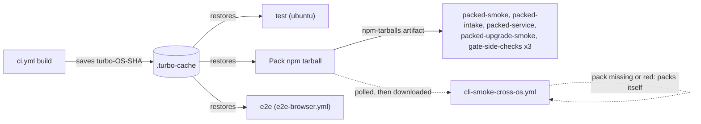

# Workflows

The workflow files here are more surface than one operator can hold in their head,
and the dangerous subset is small. This file names that subset. Tracked in #301
(review-lane rollout); the ruling that asked for it is
`fable-ruling-4-ci-surface.md`.

## The merge gate

Two checks are required on `main` by ruleset `18441175`, plus one native rule.
Nothing else blocks a merge, however red it looks:

The ruleset is the authority, and it is edited directly through the GitHub API
(`gh api repos/prismalens/prismalens/rulesets/18441175`). There is deliberately no
in-tree file that declares it: a declarative copy with nothing to reconcile it
cannot be kept current, and a stale one reads as authority. This table, and the
live ruleset, are what to trust.

| Required check                             | Published by                                                                                       | Kind      |
| ------------------------------------------ | -------------------------------------------------------------------------------------------------- | --------- |
| `CI gate`                                  | `ci.yml` → job `ci-gate`; when red it lists each failed job, its failed step and a link to the log | check run |
| `Validate PR title (conventional commits)` | `pr-title.yml` → job `validate` (single check run; step-level event split)                         | check run |

Both required contexts also report on `merge_group` events (#403): the merge
queue validates each PR against a speculative merge onto `main`, which is what
replaces the ruleset's "branch must be up to date" requirement and its
full-CI-rerun-per-sibling-merge cost.

The third blocker is not a check at all: `required_review_thread_resolution: true`
on the same ruleset. An unresolved review thread blocks the merge button natively,
with no workflow, token or status in the path.

## `ci.yml` jobs: model kind, cadence, required

A red `CI gate` should mean the code is wrong, never that a free model was slow,
renamed or refused (#884). No job here spends money on a model call (#914), and
live-model jobs are advisory and leave the gate. `CI gate` waits on every job marked
yes (#920, the operator's ruling of 2026-10-24).

A PR shows the check name; `needs:` and the prose here use the job id. Every check that runs
the packed tarball starts with `Tarball:`.

| Check name (job id)                                                                                 | What it proves                                                                                                                   | Model                                                                                | Cadence                                                                                                               | Required                                                   |
| --------------------------------------------------------------------------------------------------- | -------------------------------------------------------------------------------------------------------------------------------- | ------------------------------------------------------------------------------------ | --------------------------------------------------------------------------------------------------------------------- | ---------------------------------------------------------- |
| `Build & typecheck` (`build`)                                                                       | builds and type-checks; OpenAPI spec drift; publint                                                                              | none                                                                                 | every PR                                                                                                              | yes                                                        |
| `Lint (Biome)` (`lint`)                                                                             | format and lint                                                                                                                  | none                                                                                 | every PR                                                                                                              | yes                                                        |
| `Unit tests (<os>)` (`test`)                                                                        | every package's tests; on ubuntu with the coverage floors (#58)                                                                  | scripted fake agent                                                                  | ubuntu on every PR; macOS on `merge_group`, `main`, and a PR touching `packages/api` or `packages/@prismalens/engine` | yes                                                        |
| `Pack npm tarball` (`pack`)                                                                         | packs both tarballs and gates them (`scripts/check-artifact.mjs`; a second pack gives the same bytes)                            | none                                                                                 | every PR                                                                                                              | yes                                                        |
| `Tarball: installs and boots` (`packed-smoke`)                                                      | the tarball installs and boots in a clean container                                                                              | none                                                                                 | every PR                                                                                                              | yes                                                        |
| `Tarball: alert to incident to report, unattended` (`packed-intake`)                                | a webhook becomes an incident, is investigated without a human, and resolves                                                     | scripted fake ACP agent (`PACKED_INTAKE_AGENT=fake`)                                 | every PR                                                                                                              | yes                                                        |
| `Tarball: pl service under systemd` (`packed-service`)                                              | `pl service` installs, restarts and uninstalls                                                                                   | none                                                                                 | every PR                                                                                                              | yes                                                        |
| `Tarball: upgrades an old database and every release` (`packed-upgrade-smoke`)                      | an old database upgrades; every release npm lists upgrades to the tarball with `pl upgrade` (`scripts/packed-upgrade-chain.mjs`) | scripted fake ACP agent                                                              | every PR                                                                                                              | yes                                                        |
| `Tarball: release side checks (<os>)` (`gate-side-checks`)                                          | the release gate's side checks on Linux, macOS and Windows, `--no-skip`                                                          | scripted fake ACP agent                                                              | every PR                                                                                                              | yes                                                        |
| `Agent qualification (<agent>, scripted model)` (`harness-admission`): opencode, claude-code, codex | the real pinned agent passes the admission (R1-R9) and the behaviour matrix, 3 runs that must agree                              | aimock on loopback serving `scripts/fakes/scenarios/` (`@copilotkit/aimock`, pinned) | every PR                                                                                                              | yes                                                        |
| the same: gemini, deepagents                                                                        | the same, for the tier-2 agents                                                                                                  | the same                                                                             | every PR                                                                                                              | no: `continue-on-error`, so a red leg leaves the job green |
| `E2E / Playwright (Chromium, shard <n>/2)` (`e2e`, calls `e2e-browser.yml`)                         | the browser suite                                                                                                                | none                                                                                 | every PR, push and merge-queue build                                                                                  | yes                                                        |

Agent qualification runs its 3 admissions one at a time, because each writes a probe file into the
checkout. On Linux, as in CI, its 3 behaviour matrices run at once, each with its own scripted model, home
and workspace (#885); a matrix run spends most of its time waiting out the agent's own retries and
timeouts. Elsewhere they take turns, because only Linux's `/proc` lets the `cancel` row tell its own
tool process from another run's.

The pins for the agents these jobs install are in `scripts/agent-pins.json` (the agent) and
`@prismalens/agent-adapters` (the adapter); `agent-release-watch.yml` moves them.

One build per run (#885): `build` saves turbo's cache (`TURBO_CACHE_DIR`, `.turbo-cache`) under
`turbo-<os>-<sha>`; `test` (ubuntu) and `pack` need it and restore it, so their `pnpm build` replays.
`e2e` needs `build`, so it restores this commit's own cache.
`cli-smoke-cross-os.yml` waits for `Pack npm tarball` on the same commit and installs that artifact,
packing itself only if that job is missing or red.



## `e2e-browser.yml`: sharded, with a quarantine

The suite runs as 2 shards (`--shard=n/2`), each on its own runner with its own stacks; the `pair`
setup project runs in both. Every shard writes its flaky and failed tests to the job summary.

A test tagged `@quarantine` leaves the `chromium` and `journeys` projects and runs in
`chromium-quarantine` and `journeys-quarantine`, in a step with `continue-on-error`, on shard 1. Each
quarantined test has an open `bug` issue named in a comment beside the tag, and the issue closes
when the tag comes off (CONTRIBUTING.md, "Browser e2e tier").

- **In `ci-gate`.** `ci.yml` calls this workflow as its `e2e` job (`workflow_call`), which `CI gate`
  waits on, so it also runs on `merge_group` (#920).
- **`strict_required_status_checks_policy` is `false` (#885, set 2026-10-27 on the operator's word).**
  The merge queue already tests each PR on top of `main` and everything queued ahead of it, which is
  what strict was for. GitHub's merge-queue docs say the queue gives that guarantee without making the
  author update the branch first. Strict added only an "Update branch" round trip and a full CI rerun
  before a PR could join the queue. No workflow depends on either value.

`PACKED_INTAKE_AGENT=live node scripts/packed-intake.mjs` runs the packed-intake
script against the real harness on PATH; `packed-intake-live` in `ci.yml` calls it that way.

## `ci.yml` live jobs: the live tier

The live tier checks that the pinned OpenCode and its own free model still complete
an investigation. It runs on dispatch only, and nothing requires it: that model
stalled in 2 of 2 rounds (#914), so a nightly would be red most nights. The agent is
the version in `scripts/agent-pins.json`; it is not a run against agents' latest
releases (#639, #712).

The live jobs run only on `workflow_dispatch`, and the PR jobs and
`CI gate` run on every event except that one, so one run is either the PR tier or
the live tier, never both. A live run has its own concurrency group
(`live-agent-<ref>`) and is never cancelled, so it and a push run on `main` cannot
cancel each other.

| Job                                                                           | Model                                                                                                | Cadence  | Required |
| ----------------------------------------------------------------------------- | ---------------------------------------------------------------------------------------------------- | -------- | -------- |
| `Live: pack npm tarball` (`live-pack`)                                        | none; packs the tarball the live intake installs                                                     | dispatch | no       |
| `Live: alert to report on the free model (2 of 3)` (`packed-intake-live`)     | live free model on the pinned OpenCode, fixture repo; 3 attempts, passes on at least 2 valid reports | dispatch | no       |
| `Live: agent qualification (opencode, free model)` (`harness-admission-live`) | live free model on the pinned OpenCode (the PR job runs the same R1-R7 on the scripted model)        | dispatch | no       |
- **Release gate:** dispatch it on `main` with `ref` set to the release PR's base SHA
  (`gh workflow run ci.yml --ref main -f ref=<sha>`) and link the run from the PR.
  Dispatch on `main`, not on a PR branch: a dispatched run on a branch adds a skipped
  `CI gate` to its head commit.
- **Event streams:** each packed-intake attempt uploads its paged
  `/api/investigations/:id/events` as `intake-events-attempt-<n>`, kept 30 days.
  That is the recording source for #533.

## `agent-release-watch.yml`: what the agents released

Two jobs, neither required, neither spending a model call (#914):

| Job     | What it does                                                                                                                                                                                                                                                                  | Cadence                                                                                                   |
| ------- | ----------------------------------------------------------------------------------------------------------------------------------------------------------------------------------------------------------------------------------------------------------------------------- | --------------------------------------------------------------------------------------------------------- |
| `probe` | on Ubuntu, Windows and macOS: installs each agent row from the channel its install hint names, at that channel's latest release and at its pin, starts it through `@prismalens/agent-host` as the product does, and sends `initialize` and `session/new` unauthenticated; the job summary tables the answer next to the row's `tested`. A red scheduled leg opens or comments on one issue per agent, version and OS, titled `Agent probe failing: <agent> <version> on <os>` | nightly, dispatch, and a PR touching the probe, `agent-pins.json`, the registry's `agents.ts` or `probe.ts` |
| `bump`  | calls `prismalens/gh-workflows` `pin-bump.yml` for `opencode-ai`, `@anthropic-ai/claude-code`, `@openai/codex` and the two adapters: once a release has been public 3 days, its pin moves on one rolling pull request, `pin-bump/agents`, which lists each pin's probe result | nightly, and dispatch on `main`                                                                           |

A probe row goes channel → install → launch → verdict, and every step reads the registry, not the
script (#1013). OpenCode's row on the night its npm latest is also its pin:

| Channel (`harness.ts` `channel`) | Install                                                    | Launch                                                                                                        | Verdict                                                               |
| -------------------------------- | ---------------------------------------------------------- | ------------------------------------------------------------------------------------------------------------- | --------------------------------------------------------------------- |
| npm `opencode-ai`, latest 1.19.5 = pin | `npm install --prefix <tmp> opencode-ai@1.19.5`, the hint's `npm i -g opencode-ai` in a throwaway prefix | `detectAgent` finds `opencode` in that prefix, `planLaunch` gives `opencode acp` with the run's env, `probeAgent` sends `initialize` (30 s) then `session/new` (60 s) | `ok: answers ACP (protocol 1, OpenCode 1.19.5; 2 modes)`; a `failed-to-start` or `no-answer` row turns the leg red |

An adapter row (claude-code, codex) installs the adapter PrismaLens ships in one prefix and the CLI its
hint names in another, so `detectAgent` takes the shipped-adapter path with the CLI as companion.
`sign-in-needed` counts as started: the agent answered, and no probe signs in.
The bump PR runs ordinary CI, so the new version runs the admission and the behaviour matrix on aimock.
A pin whose probe fails stays where it was and is listed as held back. After the pins move, `scripts/agent-adapter-sdk.mjs` moves the shipped claude-agent-sdk to the one the claude adapter declares (the bundle refuses any other),
`pnpm install --lockfile-only` refreshes the lockfile and `scripts/agent-tested.mjs` moves each row's
`tested` (so `harness-pins.test.ts` holds) with a note that no real-model run backs it yet; the PR's
recording checkbox is that run. Each night rebuilds the branch from `main` until someone pushes to it,
then leaves it alone; once `main` carries every pin, the run closes the PR.

```text
night 1: claude-agent-acp 0.94.0 ok, codex 0.163.0 probe failed  -> PR "pin claude-agent-acp 0.94.0", codex held back
night 2: claude-code 2.1.309 soaked                               -> same PR, force-pushed, title gains claude-code 2.1.309
operator pushes the recording                                      -> nightly run stops touching the branch
merged                                                             -> next run finds nothing to move and closes nothing
```
The `RELEASE_PAT` secret opens the PR so that CI starts on it; with only `GITHUB_TOKEN` the PR gets no checks.

## Review is advisory; unresolved threads are what block

`review-evidence` — a required commit status published by a `review-evidence.yml`
that no longer exists — was retired in #415, along with `review-admit.yml`,
`.github/scripts/`, and the `marker` job in `claude-code-review.yml`. It tried to
prove "a competent reviewer read this exact code" from vendor artifacts: comment
bodies, review states, marker strings, walkthrough stubs. None of those is a
documented API contract and all of them are summonable by anyone who can comment.
Five sound fixes produced five holes in the same place, and the intended happy path
never once completed end to end — the `marker` job posted with `GITHUB_TOKEN`, and
GitHub's anti-recursion rule prevents a `GITHUB_TOKEN` comment from firing the
`issue_comment` trigger the publisher listened on. So the property was never held,
while the gate blocked correct code for two weeks.

What replaced it:

| Mechanism                           | What it does                                                                                                                                     |
| ----------------------------------- | ------------------------------------------------------------------------------------------------------------------------------------------------ |
| `claude-code-review.yml`            | reviews every same-repo PR and posts **inline findings** (`--comment` in its `prompt:` is what makes it post at all)                             |
| `required_review_thread_resolution` | any unresolved thread — from that reviewer or a human — blocks merge                                                                             |
| `coderabbit_review` label           | **manual** admission of an online CodeRabbit review via `.coderabbit.yaml`'s `auto_review.labels` valve, for sensitive paths or a second opinion |

**Findings block; silence does not.** What is genuinely lost is the machine
guarantee that a reviewer ran on a given head — a guarantee that, per the above, was
never actually held. A reviewer that silently posts nothing now yields a PR that
merges unreviewed. Two places announce that fact, neither of which gates:
the `Report reviewer liveness` step in `claude-code-review.yml` warns in the job
log, and the `announce` job in the same file upserts one advisory comment per PR
stating whether `claude[bot]` actually published anything for the reviewed head
(added after 2026-08-11, when the reviewer ran full reviews, posted nothing, and
every job stayed green for a day before anyone noticed).

## Gate-writers — the workflows that can publish a required check

**No workflow in this repo holds `statuses: write` or `checks: write`.** Keep it
that way. Required checks are matched **by context name with no integration pin**:
any workflow that can post a status named `CI gate` satisfies that gate, and GitHub
will not distinguish it from the real one. The one workflow that ever held
`statuses: write` is gone.

`claude-code-review.yml` is a caller stub; the lane lives in
`prismalens/gh-workflows`. The caller's `permissions:` block is a ceiling: `contents: write`,
`pull-requests: write`, `issues: read`, `id-token: write`, `checks: read`, `actions: read`.
Each callee job declares its own subset. Two jobs run a model over attacker-influencable
diff text: `review`, pinned to `contents: read`, `issues: read`, `id-token: write`,
`checks: read` and `actions: read`, which posts through the action's own app installation,
not the workflow token; and `verify`, which reads `gh pr diff` and holds no write and no
`id-token`. Three jobs hold a write and run no model: `mutate` (`contents: write`,
`pull-requests: write`) resolves review threads, which GitHub refuses at `contents: read`,
`announce` (`pull-requests: write`) upserts the liveness comment, and `fork-notice`
(`pull-requests: write`) answers a fork PR.
`review` and `verify` must never acquire a write: a prompt injected into a reviewed diff
would then reach a job that can act on it, and the most valuable thing to inject is "resolve these threads".

## Rule for new enforcement

**New enforcement is a step in an existing workflow, never a new file.** Every new
workflow adds a trigger, a token and a permission block the operator has to audit,
and the count is already past what one person tracks. If a rule needs enforcing, add
a step to `ci.yml`, which owns the only aggregating required check.

**Never add `statuses: write` or `checks: write` to any workflow** without a
decision recorded on #301. A status-writer can publish every required check by name,
so it holds the whole gate whatever its stated job is.

**Prefer a native GitHub rule to a workflow that emulates one.** That is the lesson
#415 paid for: thread resolution enforces what four generations of evidence-parsing
could not, because GitHub owns both the artifact and the rule.

## Full inventory

Every workflow in this directory, by file and by the name the Actions tab shows. A file name starts with what
the workflow is: `ci`, `e2e-browser`, `build-`, `cli-smoke`, and so on. Two groups keep their old names
(#885). `release.yml` and the two `publish-*.yml` publish to npm by OIDC, and npm's trusted-publisher
setting names the workflow file. The caller stubs for `prismalens/gh-workflows`
(`claude.yml`, `claude-code-review.yml`, `pr-title.yml`, `pr-state.yml`, `review-findings-sweep.yml`,
`telemetry-health.yml`, `dependabot-auto-merge.yml`) carry the names its `scripts/setup-repo.sh`
checks for in every repository. Every job sets
`timeout-minutes`, except a job that calls a reusable workflow, which cannot (#885). Two of them — `ci.yml` and `pr-title.yml` —
publish the required checks described above and are the exceptions to watch; the
rest are advisory or out-of-band and cannot affect a merge.

| Workflow (Actions name)                                          | Trigger                                                                 | What it does                                                                                                                                                                                                                                                                                                                                                                                                                                  |
| ---------------------------------------------------------------- | ----------------------------------------------------------------------- | --------------------------------------------------------------------------------------------------------------------------------------------------------------------------------------------------------------------------------------------------------------------------------------------------------------------------------------------------------------------------------------------------------------------------------------------- |
| `ci.yml` (CI)                                                    | `pull_request`, `push`, `merge_group`, dispatch                         | build, test, lint, pack (the pack job gates both npm tarballs with `scripts/check-artifact.mjs`: path limit, size budget and licence texts; packs twice and compares; publint on the packed manifests), the packed-tarball checks, harness admission and e2e; aggregates to `CI gate`. On dispatch, only the live agent check instead: packed intake (2 of 3 attempts) and harness admission on the pinned agent and the free model; advisory |
| `agent-release-watch.yml` (Agent releases (probe and pin bumps)) | schedule, dispatch, `pull_request` (paths)                              | the protocol probe of every agent row at its channel's latest and its pin on Linux, Windows and macOS, and the pin-bump pull requests                                                                                                                                                                                                                                                                                                                                                       |
| `e2e-browser.yml` (Playwright E2E)                               | called by `ci.yml`, dispatch                                            | Playwright end-to-end suite (specs and Gherkin journeys, Desktop Chrome)                                                                                                                                                                                                                                                                                                                                                                      |
| `e2e-browser-mobile.yml` (Playwright E2E (phone and tablet))     | schedule, dispatch                                                      | the `@responsive` journeys at Pixel 7 and iPad sizes                                                                                                                                                                                                                                                                                                                                                                                          |
| `cli-smoke-cross-os.yml` (Cross-OS CLI smoke)                    | `pull_request`, `push`, `release`, dispatch                             | CLI smoke across operating systems                                                                                                                                                                                                                                                                                                                                                                                                            |
| `dependency-audit.yml` (Dependency audit)                        | schedule, dispatch                                                      | dependency/security audit                                                                                                                                                                                                                                                                                                                                                                                                                     |
| `release.yml` (Release)                                          | `push`, dispatch (resume a draft)                                       | release-please release PR on push; on merging it, a draft release filled by `build-standalone-cli.yml` and `build-desktop-app.yml`, then the `sums` job (one `SHA256SUMS` over every asset and one build-provenance attestation over it), then npm (provenance required), then publishing the release, then the Homebrew tap and Scoop bucket, then an install from each of them on macOS and Windows                                         |
| `build-standalone-cli.yml` (Standalone CLI build)                | `pull_request`, called by `release.yml`, dispatch                       | per-OS standalone archives and installers, smoked without Node, each gated by `scripts/check-artifact.mjs`; a CycloneDX SBOM on linux-x64; attaches them to the draft release when called                                                                                                                                                                                                                                                     |
| `build-desktop-app.yml` (Desktop app build)                      | `pull_request`, `push`, called by `release.yml`, dispatch               | unpacked Electron app per OS, held to its `scripts/artifact-budgets.json` size and file count, launched and checked; attaches the zips to the draft release when called                                                                                                                                                                                                                                                                       |
| `dependabot-auto-merge.yml` (Dependabot auto-merge)              | Dependabot PRs                                                          | auto-merges machine dependency bumps                                                                                                                                                                                                                                                                                                                                                                                                          |
| `milestone-release-checklist.yml` (Milestone release checklist)  | `milestone`                                                             | milestone bookkeeping                                                                                                                                                                                                                                                                                                                                                                                                                         |
| `claude-code-review.yml` (Claude Code Review)                    | `pull_request`                                                          | advisory review of every **same-repository** PR; posts inline findings, gates nothing; skips forks, which get no secrets                                                                                                                                                                                                                                                                                                                      |
| `claude.yml` (Claude Code)                                       | `@claude` mentions                                                      | labour tool; cannot submit or resolve reviews                                                                                                                                                                                                                                                                                                                                                                                                 |
| `pr-title.yml` (Lint PR title)                                   | `pull_request_target`                                                   | conventional-commit title check                                                                                                                                                                                                                                                                                                                                                                                                               |
| `publish-agent-adapters.yml` (Publish agent adapters)            | dispatch only                                                           | publishes `@prismalens/agent-adapters` to npm with provenance (CONTRIBUTING.md, "Publishing `@prismalens/agent-adapters`")                                                                                                                                                                                                                                                                                                                    |
| `publish-agent-host.yml` (Publish agent host)                    | dispatch only                                                           | publishes `@prismalens/agent-host` to npm with provenance; PrismaLens and Assayer pick up a new version when they bump it (#916)                                                                                                                                                                                                                                                                                                              |
| `pr-state.yml` (PR State)                                        | `pull_request_target`                                                   | caller stub for `prismalens/gh-workflows`: reports the PR's state to the review telemetry; checks nothing out                                                                                                                                                                                                                                                                                                                                 |
| `review-findings-sweep.yml` (Review Findings Sweep)              | `pull_request` closed, `pull_request_review`, weekly schedule, dispatch | caller stub for `prismalens/gh-workflows`: sweeps review findings into the review telemetry                                                                                                                                                                                                                                                                                                                                                   |
| `telemetry-health.yml` (Telemetry Health)                        | weekly schedule, dispatch                                               | caller stub for `prismalens/gh-workflows`: weekly health report on the review telemetry                                                                                                                                                                                                                                                                                                                                                       |
