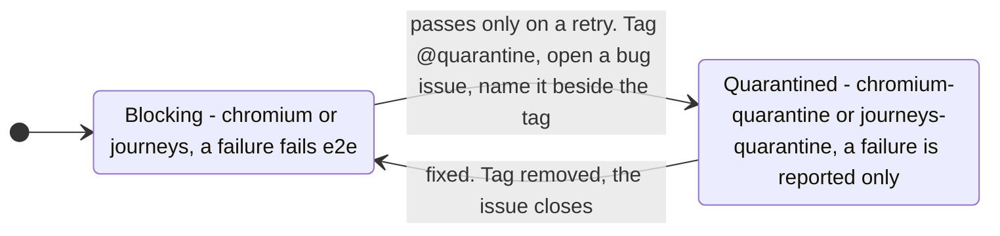

# Contributing to prismalens

Thanks for your interest in improving prismalens — a local-first SRE
incident-investigation tool.

## Contribution status

**prismalens is open source (Apache-2.0) but is not accepting outside code
contributions yet.** The codebase is moving fast pre-1.0 and the review
bandwidth goes into the release. What IS very welcome right now: bug reports,
feature requests, and discussions — use the issue templates. Forking is of
course fine; that's what the license is for.

When code contributions open, they will be gated by the Developer Certificate
of Origin (DCO, `Signed-off-by` on every commit) under Apache-2.0
inbound=outbound. This section will be updated when that happens.

Alongside the DCO, a one-time **Contributor License Agreement** ([CLA.md](CLA.md))
will apply. It exists purely for IP hygiene — it keeps the Project's copyright in
one clean place, as is standard for open-core projects — and it
does not change the license: your contributions remain licensed to everyone under
Apache-2.0, inbound = outbound. It is **not in force yet**: no CLA check runs on
pull requests while outside code contributions remain closed, and the signing
mechanism will be introduced at the same time they open, not before. Nothing is
required of you until then.

## Ground rules

- **The trunk branch is `main`, and it is protected.** Every change lands
  through a pull request; direct pushes to the trunk are not allowed (for
  anyone, including the maintainer).
- **Never commit secrets.** No API keys, tokens, connection strings, or private
  content. prismalens runs against real services' code and telemetry; keep
  fixtures and log excerpts synthetic.
- Keep PRs focused. One logical change per PR makes review fast.

## Development setup

Requirements: **Node 24** (see `.nvmrc`) and **pnpm** (this repo pins pnpm via the
`packageManager` field; `corepack enable` will select the right version). It is
a Turborepo monorepo (NestJS API + TanStack Start UI, with Prisma/SQLite).

```bash
git clone https://github.com/prismalens/prismalens.git
cd prismalens
pnpm install

pnpm build        # turbo run build
pnpm typecheck    # turbo run typecheck
pnpm test         # turbo run test
pnpm --filter @prismalens/frontend test:e2e  # Playwright e2e suite: one isolated, seeded stack per worker on ports 3000/3001, 3002/3003, ...
pnpm format-and-lint        # biome check . (lint + format), then the frontend's look gates (lint:look)
pnpm format-and-lint:fix    # biome check . --write
```

Run the app locally (API + frontend):

```bash
pnpm db:init      # initialise the local SQLite database
pnpm dev          # turbo run dev (or dev:api / dev:frontend)
```

There is no login, and in dev no pairing step either. The first page request from a browser with no device session makes `vite dev` mint an operator link, redeem it through the real API and set the device cookie, so `localhost:3000` opens straight into the app. Set `PRISMALENS_DEV_PAIR=off` to pair by hand instead (the dev API still logs `Open this machine's session: <link>`). `pnpm db:init` on an empty database seeds demo data (~60 alerts, incidents, investigations) when `NODE_ENV=development` or `PRISMALENS_SEED_DEMO=1` — the same gate e2e tests and CI use to force it outside development. `pnpm --filter @prismalens/database db:seed` reruns the seed directly.

To work on the Electron app, run `pnpm dev:desktop`. It starts the API, the frontend and the desktop together, and the window loads the Vite dev server (`PRISMALENS_DESKTOP_DEV_URL`, default `http://localhost:3000`) and pairs itself, with hot reload for the renderer and a restart of Electron on every compiled change to `packages/desktop`. The packed-backend path (`pnpm --filter @prismalens/desktop stage:backend`, then `start`) is for checking the shipped artifact, not for day-to-day work.

### Browser e2e tier

The Playwright suite runs in CI as its own workflow (`.github/workflows/e2e.yml`, chromium-only) on
every pull request and on pushes to `main`. It is **not a required check yet** — it is promoted to
required when the last 20 `main`-branch runs are green *and* none of them consumed a Playwright
retry, and once the storm-intake spec has landed. The rationale, the promotion trigger, and the
journey-by-journey coverage matrix live in
[`packages/frontend/e2e/README.md`](packages/frontend/e2e/README.md).

Two things to know before running it locally:

- Each Playwright worker gets its own API, Vite, workspace and database; worker *n* binds
  ports 3000+2n and 3001+2n (2 workers locally, one per CPU in CI). Stop `pnpm dev` first, or move
  the base ports with `PRISMALENS_FRONTEND_PORT`/`PRISMALENS_PORT`. `--workers=1` runs one stack.
- The servers get a PATH holding only node, pnpm, git and the fake agents, so a real `claude` or
  `opencode` on your machine never answers. See
  [Agents on PATH](packages/frontend/e2e/README.md#agents-on-path).
- On failure, CI uploads the `playwright-report` artifact (7-day retention); read that rather than
  re-running blind.

A test that passes only on a retry is quarantined, not left to retry. Tag it `@quarantine` (a
`{ tag: "@quarantine" }` option, or the tag line above a Gherkin scenario) with a comment naming its
open `bug` issue, one per test. It then runs in the non-blocking `chromium-quarantine` and
`journeys-quarantine` projects, and the issue closes only when the tag comes off. Every run lists its
flaky and failed tests in the job summary.



In `packages/frontend/e2e/features/inbox.feature`:

```gherkin
  # Quarantined: #891 - the inbox's new-alert-row journey passes on its first attempt
  @quarantine
  Scenario: A new alert's row appears without a reload
```

Every PR touching `packages/frontend` ships or extends a spec covering its changed surface, and
updates the coverage matrix if it adds or removes a route (see `AGENTS.md`).

Journeys (`packages/frontend/e2e/features/*.feature`) and the API lifecycle scenarios
(`packages/api/test/scenarios/`) make every precondition through the product: an alert from the
fake Alertmanager through the real webhook, a run by the fake ACP agent, an operator's click or
API call. Nothing is seeded or written to the database by hand. The API scenarios start from an
empty workspace; the e2e stack's demo seed is there only for screens that read. A walk finding is
fixed together with the journey or scenario that would have caught it. How to write one:
[`packages/frontend/e2e/README.md`](packages/frontend/e2e/README.md#writing-a-journey).

### Agent-loop checks: the real agent on a scripted model, live on dispatch

A PR never waits on a live model, and nothing here spends money on one (#884, #914). The agent loop is checked these ways:

| Check | Model | Runs | Where |
| --- | --- | --- | --- |
| `test`, `packed-intake`, `packed-upgrade-smoke`, `gate-side-checks` | the scripted ACP agent (`scripts/fakes/fake-acp-agent.mjs`) | every PR | `ci.yml` |
| `harness-admission`, one leg per agent: the admission (R1-R9) and the behaviour matrix | the real pinned agent, its model calls served by aimock (`@copilotkit/aimock`, pinned) from `scripts/fakes/scenarios/` | every PR; tier-1 legs gate, tier-2 legs do not | `ci.yml` |
| protocol probe | none: `initialize` and `session/new` against each row's latest release | nightly | `agent-releases.yml` |
| pin bump | none: a pull request once a release has soaked 3 days | daily | `agent-releases.yml` |
| `harness-admission-live`, `packed-intake-live` | the real pinned OpenCode on its own free model | on dispatch, and before a release | `ci.yml` (dispatch only: that model stalls, so a nightly would be red most nights) |

Tier 1 is opencode, claude-code and codex; gemini and deepagents (`dcode`) are tier 2. A row's `tested` comes from CI only: it equals the pin CI installs (`scripts/agent-pins.json` for the agent, `@prismalens/agent-adapters` for the adapter, checked by `harness-pins.test.ts`) and moves only in a merged bump PR, whose CI runs the matrix on the new version.

Run one agent's qualification yourself, with the agent on PATH at its pin:

```bash
pnpm --filter "@prismalens/contracts..." build
node scripts/admission-fake.mjs claude-code "$PWD" --repeat 3
```

```text
ROW cancel: pass [cancelled; error: investigation cancelled; 5s]
ROW http-500: pass [fault; error: Internal error: API Error: 500 scripted server error. ...; 3s]
...
run 1/3: ok R1-R4=pass R5=pass R6=skipped R7=pass R8=pass R9=pass | cancel=pass empty-response=pass ...
run 2/3: ok R1-R4=pass R5=pass R6=skipped R7=pass R8=pass R9=pass | cancel=pass empty-response=pass ...
run 3/3: ok R1-R4=pass R5=pass R6=skipped R7=pass R8=pass R9=pass | cancel=pass empty-response=pass ...
```

The driver starts aimock on `127.0.0.1` with that agent's fixtures, points the agent at it from a throwaway
home (an OpenCode provider in `XDG_CONFIG_HOME`, `ANTHROPIC_BASE_URL` for Claude Code, a `CODEX_HOME` provider
with `wire_api = "responses"`, `GOOGLE_GEMINI_BASE_URL` for Gemini, a `DEEPAGENTS_HOME` `config.toml` for dcode),
then runs `packages/@prismalens/engine/scripts/acp-admission.ts` and `acp-matrix.ts` through the real engine. It exits
nonzero if a run fails or the runs disagree. `--only admission|matrix`, `--rows a,b` and `--journal` (each request's
offered tools and which fixture answered it) narrow a local run.

#### The behaviour matrix

Each row is one file in `scripts/fakes/scenarios/rows/`: the fixtures that script the model, the engine-side outcome
PrismaLens must reach, and any agent that legitimately differs, with its reason. A row passes on what the engine
observed (its events, the files and processes the run left), never on model text. The fixtures are shared by every
wire; `scripts/fakes/scenarios/agents.json` maps each agent's shell tool, read from aimock's journal. Outcomes:
`report` a clean report; `fault` the step's tool ran, then an error and no report; `error` an error and no report;
`exited` the agent quit before answering and PrismaLens said so; `cancelled` the run ended cancelled and the tool's
process is gone; `cancelled-orphaned` a known agent bug: cancelled, but the tool's process outlives the run, and the
row fails once the agent fixes it.

| Row | PrismaLens must | opencode | claude-code | codex | gemini | dcode |
| --- | --- | --- | --- | --- | --- | --- |
| R1-R4 admission | run in the clone, read allowed, report validates | pass | pass | pass | known failure: Gemini's ACP shell update carries no output, so the nonce never reaches PrismaLens (google-gemini/gemini-cli#29930) | pass |
| R5 resume | reopen with `session/load`, no replayed history as new events | pass | pass | pass | known failure: Gemini answers `session/load` before its replay ends (google-gemini/gemini-cli#29707; worked around in #942) | pass |
| R6 user model | serve the user's OpenCode model | pass | n/a: OpenCode only | n/a | n/a | n/a |
| R7 resume after a failed report | reopen after a broken report | n/a: no base-URL proxy | pass | n/a: no base-URL proxy | n/a: no base-URL proxy | n/a: cannot reopen |
| R8, R9 gateway tool call | call `incident_get` on the first turn and the follow-up | pass | pass | pass | pass | pass (R9 n/a: cannot reopen) |
| report | `report` | pass | pass | pass | pass | pass |
| tool-call | `tool-report` | pass | pass | pass | pass | pass |
| permission-allowed | the ask is approved, the file is written, `report` | pass | pass | pass (escalated command: Codex's Ask-for-approval mode writes the workspace unasked) | pass | pass |
| permission-declined | only refused asks, no file | pass | pass | pass (escalated, as above) | pass | pass |
| cancel | `cancelled`, the tool's process gone | pass | pass | pass | pass | known failure (`cancelled-orphaned`): dcode's command outlives the cancelled run, langchain-ai/deepagents#5907 |
| not-signed-in | `error` | pass | pass | pass | pass | pass (`exited`: dcode exits before `initialize` with no provider key) |
| modes | modes and model options from `session/new` as the registry row says | pass | pass | pass | pass | pass (none, as the row says) |
| invalid-tool-args | `report` | pass | pass | pass | pass (`fault`: Gemini re-sends the request on a malformed call, then ends the turn empty) | pass |
| unknown-tool | `report` | pass | pass | pass | pass | pass |
| empty-response | `fault` | pass | pass | pass | pass | pass |
| length-cutoff | `fault` | pass (the prompt limit ends it: OpenCode re-asks) | pass | pass | pass | pass (prompt limit) |
| refusal | `fault` | pass | pass | pass | pass (as a safety stop) | pass |
| http-500 | `fault` | pass | pass | pass | pass | pass |
| http-429 | `report` after the agent's own retry | pass | pass | pass | pass | pass |
| stream-dropped | `fault` | pass | pass | pass | pass | pass |
| slow-first-token | `fault`: the engine's prompt limit (15 s here) ends the turn | pass | pass | pass | pass | pass |
| parallel-tool-calls | two tool results, `report` | pass | pass | pass | pass | pass |

As of CI run 40182891095 on 7b68402a (3 agreeing runs per leg). The gemini and dcode legs are red on the cells in bold; they gate nothing until those are fixed.

`R1-R9` (the admission) run beside the matrix in every leg. A fault a wire cannot express is `n/a` with its
reason in the row's `na` field, and the table shows it; none is today: aimock serves every fault on the wires these
agents use, and on Gemini's wire, which has no refusal, the refusal row is a safety stop (`content-filter`).

#### Turning a field transcript into a fixture

A user's run that went wrong leaves `transcript.jsonl` in the run directory: the agent's ACP traffic, not its
prompt. Say it shows a Codex run that went quiet after the provider rate-limited it. Read what the model did at each
step (a tool call, a refusal, an HTTP status) and write those steps as a row, in your own words. Here is
`rows/http-429.json`: the first request of the row's conversation gets a 429 with `Retry-After`, the agent's retry
gets a shell step, and the result of that step gets the report.

```json
{
	"row": "http-429",
	"kind": "negative",
	"title": "429 with Retry-After",
	"run": {},
	"expect": "report",
	"fixtures": [
		{
			"match": { "inConversation": "[row:http-429]", "sequenceIndex": 0 },
			"response": {
				"error": { "message": "scripted rate limit", "type": "rate_limit_error" },
				"status": 429,
				"retryAfter": 1
			}
		},
		{
			"match": { "inConversation": "[row:http-429]", "hasToolResult": false },
			"response": {
				"toolCalls": [{ "name": "$shell", "arguments": { "$command": "ls" } }]
			}
		},
		{
			"match": { "inConversation": "[row:http-429]" },
			"response": { "content": "$report" }
		}
	]
}
```

`[row:<name>]` is the marker the matrix puts in the row's prompt; `inConversation` holds on every turn of that
conversation, including the engine's report retry. `$shell` and `$command` become the agent's shell tool and its
argument, `$incident_get` the name the agent gave PrismaLens's gateway tool, and `$report` a report that validates.
Every other key is aimock's (`hasToolResult`, `sequenceIndex`, `misbehavior`, `chaos`, `streamingProfile`,
`truncateAfterChunks`; see aimock's fixture docs). Then run the row against each agent, for example
`node scripts/admission-fake.mjs codex "$PWD" --only matrix --rows http-429 --journal`, and add an `agents` entry for
any agent whose correct outcome differs.

A realistic shape may be seeded once with aimock's record mode in front of a local or Ollama Cloud model (API key),
then trimmed to the response. Never commit an agent's request body (system prompt, tool descriptions; Claude Code's
are "All rights reserved"): `scenario-fixtures.test.ts` fails on a request key or an overlong string, and no recording
is made on a subscription login.

## Database migrations

**Migration history is append-only** (0.5.0 published 2026-09-19). Never delete,
edit, rename, or squash a migration under
`packages/@prismalens/database/prisma/{sqlite,pg}/schema/`, and never tell anyone
to delete `prismalens.db`. Installed copies of PrismaLens record each migration's
checksum; an edited history is unreconcilable with a database that already
exists, and the runner refuses rather than guessing (issue #335).

### The lifecycle, end to end

SQLite app-data databases are migrated **by the app itself, at boot**, not by the
Prisma CLI: `pl up` runs on a machine with no `pnpm`, no `prisma` binary, and no
schema source. Four stages, and what carries each:

| Stage | Who does it | Where it lives | How to see it |
|---|---|---|---|
| **Author** | you, once per schema change | `packages/@prismalens/database/prisma/sqlite/schema/<timestamp>_<name>/migration.sql` | `pnpm db:migrate` |
| **Ship** | `pnpm build` | `dist/prisma/sqlite/schema/…` — `scripts/copy-migrations.mjs` stages the SQL next to the compiled runner, because `tsc` emits only JS | `ls packages/@prismalens/database/dist/prisma/sqlite/schema` |
| **Detect** | the runner, on every app start | shipped migrations minus the rows in `_prisma_migrations` | `pnpm db:init` prints what it will apply |
| **Apply + record** | the runner, in one `BEGIN IMMEDIATE` transaction | the SQL runs and its `_prisma_migrations` row is written **in the same transaction** — there is no half-applied state to repair | `pnpm exec prisma migrate status` agrees with it |

The runner writes `_prisma_migrations` byte-for-byte the way Prisma does
(identical DDL, sha256-of-the-file checksum, `applied_steps_count = 1`), so a
database it created stays legible to the Prisma CLI:

```
$ pnpm db:init
🔍 Checking database state...
   Database type: sqlite
   Migrations path: prisma/sqlite/schema
   Database file: /home/you/.prismalens/prismalens.db
   Database exists: false
   Applying migration 20260803122809_init…
   Applied 1 migration(s): 20260803122809_init.
🔄 Applied: 20260803122809_init
✅ Database initialization complete

$ pnpm db:init                      # again — nothing pending
   Database is up to date (1 migration(s) applied).
✅ All migrations are up to date

$ pnpm exec prisma migrate status --config prisma.config.ts
Database schema is up to date!
```

### When the runner refuses

It never partially applies. Each of these leaves the database exactly as found:

| `MigrationError.code` | What happened | What to do |
|---|---|---|
| `pre-release-database` | the database was created by a version before 0.5.0; that lineage was replaced by one `init` at 0.5.0 and does not upgrade | move the file aside, or point `PRISMALENS_WORKSPACE_DIR` elsewhere |
| `version-skew` | the database records a migration this build does not ship — it was written by a newer PrismaLens | upgrade PrismaLens, or point `PRISMALENS_WORKSPACE_DIR` elsewhere |
| `checksum-mismatch` | a shipped migration's SQL differs from what was applied — an edited or squashed history | restore the migration file; history is append-only. If the edit already shipped, see *Recovering a database that drifted* below — **never** delete the database |
| `history-gap` | the recorded migrations are not an ordered prefix of the shipped ones — a gap or a duplicate row | restore a *validated* `prismalens.db.bak-*` (see below), or reconcile with the Prisma CLI |
| `incomplete-migration` | a row is started-but-unfinished on SQLite (reachable only via the Prisma CLI, not this runner) | restore a *validated* `prismalens.db.bak-*` (see below). `prisma migrate resolve --rolled-back` clears the ledger row only without reverting schema changes, and is correct only when confirmed that no schema changes occurred or after manually reverting partial schema changes |
| `locked` | another PrismaLens process held the write lock for the whole retry budget | wait for it and retry |

Before applying anything to a database that already holds data, the runner takes
an online backup to `prismalens.db.bak-<epoch-ms>` next to it.

**"Restore the backup" means restore a *validated* one — not simply the newest.**
The newest backup may be the one taken immediately before the run that produced
the broken state. Check each candidate, newest first, and use the first whose
history is an ordered prefix of the shipped migrations with no unfinished rows:

```console
$ sqlite3 <candidate>.bak-<epoch-ms> \
    "SELECT migration_name, finished_at, rolled_back_at FROM _prisma_migrations
      ORDER BY migration_name;"
```

Reject it if any `finished_at` is NULL while `rolled_back_at` is NULL (that is the
`incomplete-migration` state again), or if the names are not a leading subsequence
of the migration directories this build ships. Only then copy it over
`prismalens.db` and start the app.

`prisma migrate resolve --rolled-back` writes `rolled_back_at` into `_prisma_migrations`
without reverting schema changes. Because the runner computes pending migrations by
filtering for `rolled_back_at === null`, a rolled-back migration runs again on the
next start against whatever schema state remains. Using `--rolled-back` is correct only
when confirmed that the migration failed before applying schema changes, or after
manually reverting partial schema changes first. Restoring a validated backup is the
remedy when schema state is not certain.

### Refuse-and-report on duplicate data

When a migration introduces a new unique index on populated tables (such as `account(issuer, accountId)` in `20260826180000_account_issuer_account_id_unique`), pre-existing duplicate records cause the migration to **hard-stop and refuse to apply**. Automatic de-duplication is rejected by policy because deleting auth records unattended is unsafe. The runner does not construct a `MigrationError` for duplicate data.

What the operator sees: the migration fails with a raw `SqliteError: UNIQUE constraint failed: account.issuer, account.accountId` and rolls back atomically, leaving the database and ledger untouched. Closing that gap in the runner is tracked as #496 ("db: the SQLite migration lineage refuses duplicate Account rows without reporting them").

What to do:
1. Run the diagnostic query to inspect the duplicate rows:
   ```console
   $ sqlite3 ~/.prismalens/prismalens.db \
       "SELECT issuer, accountId, GROUP_CONCAT(id, ', ') AS ids, COUNT(*) AS count
        FROM account
        GROUP BY issuer, accountId
        HAVING COUNT(*) > 1;"
   ```
2. Manually resolve the duplicate records (e.g. re-assigning ownership or removing invalid stale accounts after human inspection).
3. Re-run `pl up`.

### Recovering a database that drifted

`checksum-mismatch` is the one failure a released build can inflict on a database
that did nothing wrong: the `init` migration was edited in place three times
(#350, #352, #357) before this rule existed, so any database created before those
landed records a checksum no current build ships. Deleting the file "fixes" it and
destroys the operator's incident and investigation history. It is repairable in
place instead, and the runner's error message spells the repair out.

The ledger is the runner's only source of truth, so re-pointing the checksum alone
makes the error disappear **and leaves the schema wrong** — the DDL the edit added
is still missing. Apply the DDL and re-point the ledger in ONE transaction.

**Step 0 — take a copy you can roll back to.** Everything below is reversible only
because of this. Stop the app first, then:

```console
$ cp ~/.prismalens/prismalens.db ~/.prismalens/prismalens.db.pre-repair
```

To roll back at any point: `mv ~/.prismalens/prismalens.db.pre-repair ~/.prismalens/prismalens.db`.

**Step 1 — find what your schema is missing.** Build a reference database from the
release you are moving to and compare table lists:

```console
$ export REF=$(mktemp -d)
$ PRISMALENS_WORKSPACE_DIR=$REF pl up      # ctrl-c once it says it is listening
$ sqlite3 $REF/prismalens.db  ".tables" | tr -s ' ' '\n' | sort > /tmp/want.txt
$ sqlite3 ~/.prismalens/prismalens.db ".tables" | tr -s ' ' '\n' | sort > /tmp/have.txt
$ comm -23 /tmp/want.txt /tmp/have.txt     # tables you are missing
$ sqlite3 $REF/prismalens.db ".schema <table>"   # the CREATE statements to copy
```

Compare columns per table the same way with `PRAGMA table_info(<table>);`.

**Step 2 — apply the DDL and re-point the ledger, atomically.** The SQL below is
written for exactly one drift: the one #350/#352/#357 introduced, which is the
only one in the wild today. **Before running it, confirm step 1's diff shows
nothing but** the missing `jobs` table, its three indexes, and
`services.localCheckoutPath`. If the diff shows anything else, or a migration
other than `20260803122809_init` is named in the error, stop — this recipe does
not describe your drift, and you need the actual delta for your case.

The checksum to write is the one the error message printed as *"shipped by this
build"*; for the `20260803122809_init` drift it is
`0e7aa00150d19520db40e2faf4400c93e317e19051d891dced3541e147b7ab76`. Confirm it
matches your error before running this — a checksum copied from documentation is
only correct for the release it was written against.

```sql
BEGIN;
ALTER TABLE "services" ADD COLUMN "localCheckoutPath" TEXT;
-- paste the exact CREATE TABLE "jobs" (…) from step 1's `.schema jobs`
CREATE UNIQUE INDEX "jobs_investigationId_key" ON "jobs"("investigationId");
CREATE INDEX "jobs_status_runAt_priority_idx" ON "jobs"("status", "runAt", "priority");
CREATE INDEX "jobs_status_heartbeatAt_idx" ON "jobs"("status", "heartbeatAt");

UPDATE "_prisma_migrations"
   SET checksum = '0e7aa00150d19520db40e2faf4400c93e317e19051d891dced3541e147b7ab76'
 WHERE migration_name = '20260803122809_init';

-- Must print 1. Anything else means the ledger is not what this recipe assumes:
-- ROLLBACK instead of COMMIT.
SELECT changes();
COMMIT;
```

**Step 3 — validate.** The ledger must match the shipped SQL, and the app must boot:

```console
$ sqlite3 ~/.prismalens/prismalens.db \
    "SELECT migration_name, checksum FROM _prisma_migrations;"
$ pl up      # expect "Database is up to date (1 migration(s) applied)."
```

If `pl up` still refuses, roll back with the copy from step 0 and open an issue
with the error text — do not delete the database.

A database repaired this way is schema-identical to a fresh one; only the ordinal
position of an `ALTER TABLE`-added column differs, which Prisma does not depend on.

## Making a change

1. **Branch** off `main`: `git checkout -b fix/short-description main`.
2. **Work test-first (repo policy since #58): new code ships with tests written
   at its public seams and ≥80% per-metric coverage.** Vitest enforces this via
   per-glob `coverage.thresholds` (see `packages/cli/vitest.config.ts`) — when
   you add a module, add it (or its directory) to that map; reviewers treat a
   new source file with no threshold entry as a missing test. Pre-existing
   files are exempt until touched. Fix the implementation, not the test,
   unless the test is wrong.
3. Make sure `pnpm typecheck`, `pnpm build`, `pnpm test`, and
   `pnpm format-and-lint` all pass.
4. **Commit** using [Conventional Commits](https://www.conventionalcommits.org/):
   `feat:`, `fix:`, `docs:`, `refactor:`, `test:`, `chore:`, `ci:`, `perf:`.
5. **Open a PR** against `main`. The **PR title** must be a valid conventional
   commit — a required check enforces it (the repo squash-merges, so the PR
   title becomes the trunk commit subject).

## Code style

- Formatting and linting are handled by **Biome** — run `pnpm format-and-lint`.
  It also runs `packages/frontend/scripts/lint-look.sh`: no border as structure,
  no DOM `title` tooltip (use `Hint`), no native `<select>`, no deleted look tokens.
- **Never convert tabs to spaces or vice-versa.** Preserve the existing
  indentation of each file exactly.
- Small, cohesive files; explicit error handling at boundaries; no stray
  `console.log` debris and no hardcoded secrets.

## License headers (SPDX)

New source files carry the same two-line SPDX header as their neighbours
(`// SPDX-License-Identifier: Apache-2.0` / `// Copyright 2026 Sumit Patel`).
Nothing enforces it.

## Releases and package publishing

Two packages publish to npm: `prismalens` (the CLI) and
`@prismalens/agent-adapters`. The CLI's other first-party libraries are
`private: true` and bundled into the CLI tarball at build time, so they never
publish separately (issue #193).

Versioning and publishing run through
[release-please](https://github.com/googleapis/release-please)
(`release-please-config.json` + `.release-please-manifest.json` +
`.github/workflows/release.yml`), driven by conventional-commit titles on
`main` — there are no changesets and no pre-release tags (0001 §7, §9).

1. Every commit to `main` needs a conventional-commit title (`fix:`, `feat:`,
   `chore:`, …); release-please reads these to compute the next version.
2. On push to `main`, release-please opens or updates a release PR proposing
   the next version and a changelog.
3. Merging that PR runs the release draft-first, in one `release.yml` run,
   because the repository has immutable releases on and GitHub refuses any
   upload to a published release (#717):
   1. release-please creates the tag and a **draft** release (`draft` and
      `force-tag-creation` in `release-please-config.json`; without the forced
      tag a draft has none, and release-please could not find it next time).
   2. `standalone.yml` and `desktop.yml`, called with the tag, build from it
      and attach the archives, the CycloneDX SBOM, `install.sh`, `install.ps1`
      and the desktop zips to the draft.
   3. The `sums` job writes one `SHA256SUMS` over every asset on the draft and
      one build-provenance attestation over it, then uploads `SHA256SUMS`.
   4. npm publishes: build, `publint`, then pack + publish via npm trusted
      publishing (OIDC), no npm token secret. `NPM_CONFIG_PROVENANCE=true`, so
      a publish that cannot attach provenance fails. It goes before the release
      is published because the in-app update notice reads `releases/latest`.
   5. The draft is published (`gh release edit --draft=false`), which makes
      it immutable.
   6. The Homebrew tap and Scoop bucket are updated from the published
      `SHA256SUMS`; the job fails when `PACKAGE_MANAGERS_TOKEN` is unset.
   7. `brew install prismalens/tap/prismalens` and `scoop install prismalens` run from
      the real tap and bucket on macOS and Windows runners.

   What a failure leaves, and what finishes it, for a `v0.5.3` release whose
   previous version is `0.5.2`:

   | Job that failed | GitHub release `v0.5.3` | npm `latest` | Finish it with |
   | --- | --- | --- | --- |
   | `release-please`, after it made the tag and draft | draft, no assets | `0.5.2` | `gh workflow run release.yml -f tag=v0.5.3`. A re-run sees an existing release and builds nothing. |
   | `Resolve the draft release`, `standalone` or `desktop` | draft, some assets | `0.5.2` | **Re-run failed jobs**. An upload to a draft replaces what is there. |
   | `Publish to npm` | draft, every asset | `0.5.2`, or `0.5.3` if the publish went through | **Re-run failed jobs**. npm is skipped when the version is already on it. |
   | `Publish the release` | draft, every asset | `0.5.3` | **Re-run failed jobs**. |
   | `Update the Homebrew tap and Scoop bucket` | published, immutable | `0.5.3` | **Re-run failed jobs**. It reads the published `SHA256SUMS`. |
   | `Install from the real Homebrew tap`, `Install from the real Scoop bucket` | published, immutable | `0.5.3` | **Re-run failed jobs**, once the tap or bucket has the new version. |

   The hand-run **Release** refuses a release that is not a draft. A version
   older than the current latest release is published to npm under the
   `previous` dist-tag and not marked latest, and the tap and bucket are left
   alone.

4. Every release is a patch: `versioning: always-bump-patch` in
   `release-please-config.json` holds the line at 0.5.x whatever the commit
   types. A minor release means changing that line on purpose. To force one
   specific version, set `"release-as": "<version>"` on the `"."`
   package entry and remove it once that version publishes. A `Release-As:` commit
   footer does not work here: squash commits end with the attribution lines,
   and release-please reads footers only from a commit's last paragraph.
5. Releases are tagged `v<version>` from 0.5.0 on (`prismalens@<version>`
   before it). Publishing the release (with `RELEASE_PAT`, so the event
   reaches other workflows) also starts the registry-mode `cross-os-smoke`
   run against that version.

The release PR is created with the `RELEASE_PAT` repo secret, not the default
`GITHUB_TOKEN`: this repo forbids Actions from creating PRs, and a PR opened
with `GITHUB_TOKEN` never triggers CI (GitHub anti-recursion).

### What each release artifact carries

Each artifact is held to a standard by a gate that fails the PR or the release (#906):

| Artifact | Standard | Gate |
|---|---|---|
| npm `prismalens` | `files` allowlist, npm provenance, copied (not bundled) first-party tree (#237) | `scripts/check-artifact.mjs` (path, size, licences), publint on the packed manifest, and a second pack that must match byte for byte, in `ci.yml` |
| npm `@prismalens/agent-adapters` | one esbuild file per adapter, licence texts of everything inlined | `bundle.test.mjs` (ACP `initialize`), `check-artifact.mjs`, publint |
| Standalone archives (5) | `app/` is the npm global tree relocated, pruned; Node is the binary and its LICENSE | `check-artifact.mjs` on every target, Windows PowerShell 5.1 install and Scoop install with long paths off |
| `install.ps1` / `install.sh` | `.ps1` is ASCII only (no BOM: `irm \| iex` reads the body as text); `.sh` is UTF-8 without a BOM | `scripts/install/encoding.test.mjs`, `install.ps1 -Help` under `powershell -File` |
| Desktop zips | asar, unsigned (#697) | `check-release-paths.mjs --paths --max-mb --max-files`, `missingLicences` in `pack-desktop.mjs` |
| Every release asset | one `SHA256SUMS` and one build-provenance attestation (SLSA v1 Build L2) | `release.yml` `sums` job |
| SBOM | CycloneDX from `npm sbom` over the linux-x64 `app/` tree, `prismalens-<v>.cdx.json` | `standalone.yml` asserts `bomFormat` and an `@prismalens/api` component |

Budgets live in `scripts/artifact-budgets.json`: bytes and file count per artifact,
and the unpacked size for each desktop OS. A change that grows an artifact past its
budget raises the number in the same PR, with the reason.

The path limit is 260 - 40 = **220** characters for a 20-character username, on every
Windows prefix an artifact lands under: the npm global prefix, the installer's
`%LOCALAPPDATA%\prismalens\runtime\<v>\`, and Scoop, which unpacks the whole archive
into `_tmp` first. The deepest path today is a migration folder, whose names never
change (#335):

```
C:\Users\uuuuuuuuuuuuuuuuuuuu\scoop\apps\prismalens\0.5.3\_tmp\     63
prismalens-0.5.3-win32-x64/app/node_modules/@prismalens/database/
  dist/prisma/sqlite/schema/20261007135949_investigation_kind_agent_mode/migration.sql   149
                                                                      212 <= 220
```

So a migration folder name 9 characters longer than that one fails the PR that adds
it. The gate on a Windows archive:

```
$ node scripts/check-artifact.mjs dist/standalone/prismalens-0.5.2-win32-x64.zip
==> prismalens-0.5.2-win32-x64.zip
  installer 191/220 C:\Users\uuuuuuuuuuuuuuuuuuuu\AppData\Local\prismalens\runtime\0.5.2\ + app\node_modules\@prismalens\database\dist\prisma\sqlite\schema\20261007135949_investigation_kind_agent_mode\migration.sql
  scoop 212/220 C:\Users\uuuuuuuuuuuuuuuuuuuu\scoop\apps\prismalens\0.5.2\_tmp\ + prismalens-0.5.2-win32-x64\app\node_modules\@prismalens\database\dist\prisma\sqlite\schema\20261007135949_investigation_kind_agent_mode\migration.sql
  win32-x64 78453080 bytes, 9335 files (budget 84355077 bytes, 10269 files)
  licences: every package carries one
```

A zip is checked on Windows only (it extracts with Windows' own `tar.exe`); a
`.tgz` or `.tar.gz` anywhere.

### Publishing `@prismalens/agent-adapters`

Its pins move with the agent registry, not with a CLI release, so it publishes by
hand: run the `Publish agent adapters` workflow, which publishes with npm
provenance. To inspect the tarball locally, run
`pnpm --filter @prismalens/agent-adapters pack:npm`; it builds the package, then
writes the tarball to `packages/@prismalens/agent-adapters/dist-pack/`.

The build (`scripts/bundle.mjs`) bundles each pinned adapter, a `devDependency`,
into one ESM file under `dist/adapters/` with esbuild, and writes
`dist/adapters/bundled.json`: each adapter's version, script and the packages it
inlined. `shippedAdapter()` reads that file. `@anthropic-ai/claude-agent-sdk` is
not inlined: its licence is not permissive and the Claude adapter resolves it at
runtime, so it ships as the one `bundleDependency`, copied flat without its
dependencies, so installing the package never downloads an agent binary. Each
adapter runs the user's own `claude` or `codex`. The licence text of every inlined
package, and the SDK's, is under `THIRD_PARTY_LICENSES/`. Every input is pinned by
`pnpm-lock.yaml`; packing runs no `npm install`.

### Release-gate side checks

Before a release PR merges, `CI gate` is green on its base SHA ([`RELEASING.md`](RELEASING.md)), and the manual
walk covers what a runner cannot.
`pnpm gate:side-checks [--tarball <path>] [--only <checks>] [--no-skip]` scripts the walk's
side checks against that tarball, or packs the built CLI when no tarball is given:
the telemetry notice and its four off switches, the update notice, the workspace
lock, reset racing an investigation, the Host allowlist when pairing, and `pl upgrade`
through a local registry. On Linux it also covers the `pl upgrade` trial rollback under
`pl service`. Each check runs in its own
throwaway HOME, workspace and port, with an agent-free PATH and the repository's
fake ACP agent, so no real agent login is used. PostHog and GitHub requests go to
a local stub. A terminal is a pseudo-terminal from `@lydell/node-pty` on every OS, and `pl`
runs as `node <bin>`, so no shell shim or `script(1)` is involved. The script prints one
PASS, FAIL, SKIP or N/A line per check and exits non-zero on any FAIL, and on a SKIP
under `--no-skip`, which CI passes. `rollback` is N/A off Linux (the trial runs under
systemd) and is skipped on Linux when there is no systemd user manager or a
`prismalens.service` already exists. On Windows there is no SIGTERM: the lock check ends the holder
outright and expects the next boot to take the stale lock. CI's `Gate side checks`
job runs them on Linux, macOS and Windows on every PR and every push to `main`, and its run on the release PR's base
SHA is the gate's record.

`pnpm gate:upgrade-chain <dir-with-tarball>` is the chain behind `Packed upgrade smoke`: it reads the stable
releases from `npm view prismalens versions`, starts a local registry that proxies npm and carries the tarball
(re-versioned to the next patch when its own version is already published), installs the oldest release from 0.5.0 on, and
upgrades it release by release to the tarball with each release's own `pl upgrade`, booting after every hop and
checking an incident written by the oldest release is still in the database. The oldest release also upgrades
straight to the tarball. A release whose `pl` has no `upgrade` command is moved with `npm install -g`, and the hop says so.
`Standalone CLI` runs the installer channel over every release npm lists. On Linux and macOS each old install
runs its own `pl upgrade --version <build under test>`, with `prismalens.io/install.sh` served from this checkout and the
release check answered for the staged archive; a release whose `pl` has no `upgrade` is moved by re-running the installer. On
Windows the installer script is re-run, because `pl upgrade` there fetches the script with `irm`.

## Documentation and milestone exit gates

Product documentation lives on the documentation website at
[docs.prismalens.io](https://docs.prismalens.io), built from the source repository
[`prismalens/prismalens.io`](https://github.com/prismalens/prismalens.io). This repository carries
only the root `README.md`, package `README.md` files, and contributor process
documentation.

Each 0.x release is gated by its own Phase gate issue, which `phase-gate.yml` files
when the release's milestone is created, from the patch or minor template in
`.github/release-checklists/`. A packed walk passes on the release PR's base SHA
(see [`RELEASING.md`](RELEASING.md)), docs.prismalens.io
documents every command, flag, configuration key and page the release changed
(checked against the packed tarball, links validated on the built site), and a
minor release runs a scripted live test against the tarball, not the source
tree. A patch release walks the steps its diff changed plus a fixed core; a minor
release walks everything. Each walk's findings go in the Phase gate issue or
one linked `X.Y.Z walk findings` issue.

Milestones are versions, and exactly two are open: the current release and the
next. With `0.5.3` and `0.5.4` open, once the `0.5.3` release PR merges:

1. Finish and close the `0.5.3` Phase gate issue. A milestone closed before its
   gate issue makes `phase-gate.yml` warn on that issue.
2. Move `0.5.3`'s open issues to `0.5.4`, then close `0.5.3`.
3. Create `0.5.5`; `phase-gate.yml` files its Phase gate issue from `patch.md`
   (`minor.md` for a `0.N.0`).

`0.5.4` and `0.5.5` are then the two open milestones. Direction by theme lives in the pinned
[Roadmap and handoff](https://github.com/prismalens/prismalens/issues/881) issue,
not in milestones.

In the gate, "Docs" means the published website at docs.prismalens.io.
Repository markdown files and package READMEs do not satisfy the documentation
gate. A release can have a complete repository README and still fail the gate if
shipped features lack published documentation on the website.

## Reporting bugs and requesting features

Use the issue templates. For anything security-sensitive, **do not open a public
issue** — see [SECURITY.md](SECURITY.md).

## License

prismalens is distributed under the [Apache License 2.0](LICENSE) (see also
[NOTICE](NOTICE)). The hosted cloud / enterprise edition
(`prismalens-enterprise`) is a separate, **proprietary** product and carries
none of this repository's licensing. This repository's license is not
changing — paid features are developed in the separate proprietary repo and
never move out of (or into) this one.

If and when outside code contributions are accepted (see
[Contribution status](#contribution-status)), contributors will sign a
lightweight **Contributor License Agreement (CLA)** in addition to DCO
sign-off. The CLA exists for IP hygiene — keeping the project's copyright in
one clean place, as is standard for open-core projects (Grafana, Sentry) — and
contributions remain licensed to everyone under Apache-2.0, inbound=outbound.
