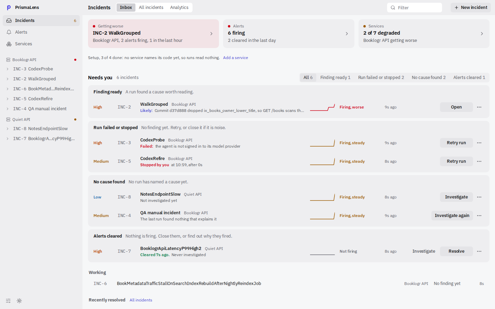
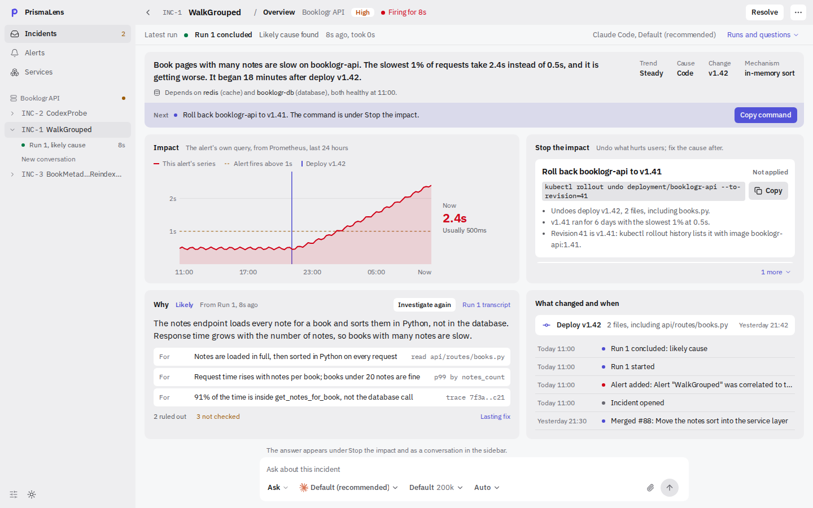

<p align="center">
  <picture>
    <source media="(prefers-color-scheme: dark)" srcset=".github/assets/banner-dark.png">
    
  </picture>
</p>

<!-- Demo video/GIF goes here: an alert arriving, the run streaming, the report on the incident. Added once it is recorded. -->

PrismaLens is a self-hosted incident investigator. When an alert arrives, the
coding agent you already use reads a snapshot of the service's code, under a
permission level you pick, and writes an **ordered-evidence report**:
hypotheses ranked from most to least plausible, each backed by evidence the
agent gathered, with no numeric confidence scores. The run, the evidence and
the cause stay on the incident.

**Who it's for:** engineers on call for services whose code they can read, who
already use a coding agent in the terminal. Alerts come from Prometheus
Alertmanager, or you write the incident yourself.

It is open source (Apache-2.0). There is no PrismaLens account, no subscription
and no model bill from us: the agent signs in with its own provider, and
PrismaLens never calls a model itself. Before you run it on your machine, read
**[what PrismaLens reads and never does](https://docs.prismalens.io/trust/)**.

> [!WARNING]
> PrismaLens is **alpha**. Any 0.x release may change behaviour or break a
> workflow; read the [release notes](https://github.com/prismalens/prismalens/releases)
> before you upgrade. See [VERSIONING.md](VERSIONING.md).

## Quick start

You need git and a coding agent on PATH; `pl doctor` lists the agents
PrismaLens knows and how to install each.

```bash
npm install -g prismalens   # needs Node.js 24+
# or, on macOS and Linux without Node:
curl -fsSL https://prismalens.io/install.sh | sh

pl doctor                   # checks this machine; needs nothing running
pl up                       # http://localhost:6473
```

Windows, Homebrew, Scoop and the desktop app (all preview) are on
[Install, upgrade and uninstall](https://docs.prismalens.io/install/).

### What happens on first run

- `pl up` creates its workspace in `~/.prismalens`: a SQLite database, a
  webhook token and logs. There is nothing else to run: no Docker, no database
  server.
- It serves the API and the dashboard on one port, reachable from this machine
  only.
- It opens your browser on a one-time link that pairs it, and prints the link.
  The link works once, for 15 minutes. There is no account: every browser
  pairs, this machine's included.
- With no coding agent on PATH it says so. The app runs, but Investigate stays
  off until one is installed.
- It prints a usage-data notice. PrismaLens counts feature use under a random
  install id, never an alert, code, a repo or a report. Nothing is sent before
  the next start; turn it off in Settings, or with `PRISMALENS_TELEMETRY=off`
  or `DO_NOT_TRACK=1`.
- Once a day it checks GitHub Releases for a newer version and prints one line
  (`PRISMALENS_UPDATE_CHECK=off` turns that off).

`pl doctor` opens an ACP handshake with each agent on PATH and reports whether
it answers, or why not. An answer is not proof of sign-in: Claude Code checks
its sign-in only when a run starts, so the doctor warns rather than passing it.
For OpenCode it names the model OpenCode serves when Settings → Agent sets
none; with no provider signed in, that is an OpenCode Zen model.

### Your first investigation

- **On your own service.** In the dashboard, Services, then New service, with
  **Repository** set to a folder or a git URL. Then Incidents, New incident,
  pick the service and click **Investigate**. The agent works in a throwaway
  clone of the repository's last commit: your checkout is never its working
  directory, and uncommitted changes are not read. A run you start uses **Ask
  always** unless Settings or the agent's own config sets another level. Reads
  and searches run, and a request to switch the agent's mode is denied, so the
  run keeps its mode; every other action the agent asks about waits for your
  Approve or Deny on the run.
- **[Try it on a broken app](https://docs.prismalens.io/guides/try-it/)**, with
  no repository or monitoring of your own. A small app runs with its monitoring
  in docker compose; you switch a fault on, and a real alert starts the
  investigation. It needs docker, Node 24, pnpm, git and a coding agent.

To have alerts open incidents on their own, point an Alertmanager receiver at
`/api/webhooks/prometheus` with the workspace's webhook token; a critical or
high alert on a known service starts an investigation on arrival. See
[Sending alerts](https://docs.prismalens.io/guides/alerts/).

## What it looks like

The Inbox groups open incidents by what each one needs from you, with one next
action per row:

<!-- Invalidated by: a change to the Inbox layout or copy (packages/frontend/src/components/inbox/). Regenerate: DESIGN_SHOTS=1 playwright test e2e/journeys/inbox-shots.spec.ts, files inbox-1440-{dark,light}.png. -->
<picture>
  <source media="(prefers-color-scheme: dark)" srcset=".github/assets/inbox-dark.png">
  
</picture>

Each incident has one overview: the situation and the next step, the alert's
own query on Prometheus, the fix to stop the impact with its command, why, and
what changed:

<!-- Invalidated by: a change to the overview layout or copy (packages/frontend/src/components/overview/). Regenerate: DESIGN_SHOTS=1 playwright test e2e/journeys/overview-shots.spec.ts, files overview-1440-{dark,light}.png. -->
<picture>
  <source media="(prefers-color-scheme: dark)" srcset=".github/assets/overview-dark.png">
  
</picture>

## How it works

- **One run, no model call.** An investigation is one coding-agent session in a
  clone of the service's repo, driven over the Agent Client Protocol (ACP).
  PrismaLens assembles the prompt, routes the agent's permission requests,
  records the stream and validates the report.
- **Your agent, its own sign-in.** Any ACP agent PrismaLens knows can run;
  with none pinned, the first one on PATH runs, and Settings → Agent picks
  another. PrismaLens never reads or stores the agent's login or API key.
- **Four permission levels.** Ask always, Auto-accept edits, Auto and Full
  access each pick the agent's own mode and decide which of its requests wait
  for you. A run an alert starts waits for nobody: it runs at Auto and refuses
  anything the agent asks. PrismaLens adds no sandbox: the agent runs as your
  user, with an allowlisted environment.
- **Every run is durable.** Events, session metadata and the report are written
  to `~/.prismalens/runs/<runId>/`, and the report exports as Markdown.

To keep it running in the background, `pl service install` (Linux and macOS);
to upgrade, `pl upgrade`, which upgrades the way you installed. Everything
else, from configuration to commands, is on
**[docs.prismalens.io](https://docs.prismalens.io)**.

## Monorepo layout

| Package | What it is |
| --- | --- |
| `packages/cli` | The `prismalens`/`pl` binary, published to npm as `prismalens`. |
| `packages/api` | NestJS API server, booted by `pl up`. |
| `packages/frontend` | The dashboard, built to static assets the API serves. |
| `packages/desktop` | The desktop app (preview): an Electron window on the same server. |
| `packages/@prismalens/engine` | The investigation run: ACP session, permission asks, report validation. |
| `packages/@prismalens/agent-adapters` | The ACP adapters shipped for agents that don't speak ACP themselves. |
| `packages/@prismalens/*` | Shared contracts, config, auth, database, integrations and logger. |

Only `packages/cli` is published to npm; the other packages travel inside its
tarball, except the desktop app, which is released as its own zips. For
development, see [CONTRIBUTING.md](CONTRIBUTING.md).

## Links

- Site: [prismalens.io](https://prismalens.io)
- Docs: [docs.prismalens.io](https://docs.prismalens.io)
- [CONTRIBUTING.md](CONTRIBUTING.md) · [VERSIONING.md](VERSIONING.md) ·
  [CODE_OF_CONDUCT.md](CODE_OF_CONDUCT.md) · [SECURITY.md](SECURITY.md)

## License

[Apache License 2.0](LICENSE); see also [NOTICE](NOTICE). The npm package also
bundles the agent adapters, including the Claude Agent SDK under Anthropic's
own terms; NOTICE lists them and their licences, and each release carries
`THIRD_PARTY_NOTICES.txt` for the code bundled into the dashboard.
