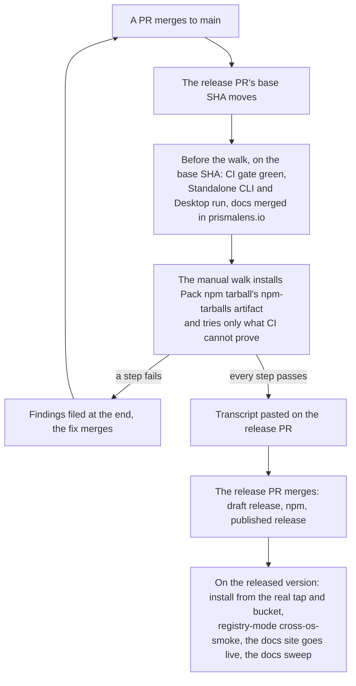

# Releasing

This file says what the release gate is and what a patch and a minor release do and do not do. Each 0.x release's Phase gate issue, filed by `.github/workflows/milestone-release-checklist.yml` from `.github/release-checklists/patch.md` or `minor.md`, tracks its own run of the gate. The workflow skips any milestone that is not `0.Y.Z`, so a major release gets no automatic issue.

## The gate
- A release publishes nothing to npm until one packed-tarball walk has passed on the release PR's base SHA. The pass is keyed to that SHA.
- release-please opens the release PR (`chore(main): release X`) but publishes nothing until it merges. So the gate blocks the release, never a merge to `main`.
- CI proves what a script can; the walk is a person at their own desk trying what it cannot, from the packed tarball, with an agent guiding one step at a time. Each step is recorded as pass or fail with a screenshot or the terminal output.
- The step-by-step walkthrough is kept maintainer-side. It describes the current UI and changes with every release, so it is not part of this repository.

## How the gate works
- Anything merged to `main` moves the base SHA. Redo the CI lines under **Before the walk** on the new base.
- The manual steps install the `npm-tarballs` artifact of `Pack npm tarball` on the base SHA, never a version from npm. They run in a fresh `mktemp -d` workspace on a port other than 6473.
- `CI gate` is the set of jobs below. A step the walk used to do by hand is gone once one of them proves it; the list of what stays manual is under **Before the walk**.
- `Standalone CLI` is green on every OS on the base SHA. Its `smoke-installer` job installs each release npm lists from 0.5.0 on, then upgrades it to the candidate with its data, and covers PATH, reinstall, the downgrade guard, a second `pl` on PATH and uninstall.
- docs.prismalens.io describes every command, flag, env var and page the release changed, checked against the packed tarball. The site goes live after npm has the version.
- Once published, the release run installs the formula and manifest it pushed from the real Homebrew tap and Scoop bucket and fails when `PACKAGE_MANAGERS_TOKEN` is unset; registry-mode `cross-os-smoke` runs on the released version, and a docs sweep catches renamed or retired identifiers.
- Failures are noted as the walk goes and filed together at the end. A failed step is rechecked once its fix merges.
- The transcript of the passing walk is pasted on the release PR.

## Before the walk
`CI gate` is the one required status check, and it waits on these jobs. A green gate on the release PR's base SHA means every one of them passed there:

| Job | What it proves |
| :--- | :--- |
| `Build & typecheck`, `Lint (Biome)`, `Test` | the code builds, type-checks and passes its tests |
| `Pack npm tarball`, `Packed smoke` | the one published tarball installs and boots in a clean container |
| `Packed intake` | a webhook becomes an incident, an unattended investigation reports, a resolution closes it |
| `Packed service` | `pl service` installs, restarts and uninstalls on a real systemd user manager |
| `Packed upgrade smoke` | a database that predates `investigation_turns` upgrades, and every release npm lists from 0.5.0 on upgrades to the tarball through its own `pl upgrade`, with its data |
| `Gate side checks` on Linux, macOS and Windows | telemetry, update notice, workspace lock, reset and Host allowlist; `pl upgrade` through npm on Linux and macOS; on Linux also the trial upgrade and its rollback |
| `Harness admission` for opencode, claude-code and codex | each agent's real binary and adapter against the scripted model |
| `E2E` | the browser suite |

Also on the base SHA, outside the gate:
- [ ] `Standalone CLI` dispatched on the base branch (`gh workflow run build-standalone-cli.yml --ref main`; `--ref` takes a branch or tag, never a SHA; it runs on no push), and the run's head SHA is the base SHA (`gh run list --workflow build-standalone-cli.yml --json headSha`).
- [ ] `Desktop` on the base. The desktop part of the walk uses its artifact.
- [ ] Docs for this release's screens merged in `prismalens/prismalens.io`.

What stays manual, because a runner cannot do it:
- one real, signed-in agent run per agent and per OS;
- `pl doctor`, and a private-repo clone through the real credential helper;
- the desktop window, tray and notification;
- Ctrl+C in a real terminal on Windows and macOS (the scripted checks end the process by signal or by kill);
- `pl upgrade` through npm on Windows, until the failure on the CI runner is fixed (#921);
- WSL2, Tailscale and the phone, when their files changed;
- a real `irm | iex` install after publish.

Flaky gate checks are tracked in #742 - Release-gate CI checks pass or fail on the same commit: App boot on Windows and Packed intake.

## Patch release
In 0.x every release is a patch (`0.N.P`), whatever its commits: fixes, features and breaking changes alike. `versioning: always-bump-patch` in `release-please-config.json` holds the line ([VERSIONING.md](VERSIONING.md)).

What a patch walk does:
- Walks only the manual steps the release's diff changed.
- Carries each unchanged step forward, with git-diff evidence that its files are untouched since the walk that last passed it.
- Runs the checks in `.github/release-checklists/patch.md`: a green `CI gate`, the scoped manual walk, registry-mode `cross-os-smoke`, the real-tap install jobs, the docs sweep and the findings record.

What a patch walk does not do:
- No full walk.
- No site review, scripted live test or close-out. Those belong to a minor.

## Minor release
A minor (`0.N.0`) happens only when a maintainer changes the `always-bump-patch` line on purpose, for a phase from the milestones ([VERSIONING.md](VERSIONING.md)).

What a minor adds to a patch:
- The full manual walk: every step in the list above. Nothing carries forward.
- The site and docs checks in `.github/release-checklists/minor.md`: reference completeness on docs.prismalens.io, the adversarial docs review, the site's claims checked against the packed artifact, re-captured imagery when the pages it shows changed, and links validated on the built site.
- A scripted live test against the packed tarball. A deterministic script, not an agent-driven run.
- The close-out: update the pinned roadmap issue, #881 - Roadmap and handoff.

## Patch and minor side by side
| | Patch (`0.N.P`) | Minor (`0.N.0`) |
| :--- | :--- | :--- |
| Manual walk scope | Steps the diff changed | Every manual step |
| Unchanged steps | Carried forward with git-diff evidence | Nothing carries forward |
| Site and docs checks | Docs sweep only | Reference completeness, adversarial docs review, site claims, imagery, built-site links, then the sweep |
| Live test | None | Scripted, against the packed tarball |
| Close-out | None | Update the pinned roadmap issue |
| What bumps the version | The default: every release | A maintainer changes `always-bump-patch` on purpose |

## Major release
Not decided yet. VERSIONING.md: "`1.0.0` is a deliberate stability promise, not just the number after `0.9`."

## Where findings go
Each walk records its findings in the Phase gate issue or one linked GitHub issue titled `X.Y.Z walk findings`: one checkbox per finding with its evidence, screenshots attached with `gh issue comment --attach`.

## Where this came from
The operator scoped the walk to the release in a ruling on #673 - release gate: a packed-tarball session gates every release PR. Full walks of every feature had taken about nine rounds, with 37 to 50 findings each. The release-train model behind it: a change that misses one release catches the next ([Rust 1.0 trains](https://blog.rust-lang.org/2014/12/12/1.0-Timeline/), [RFC 507](https://rust-lang.github.io/rfcs/0507-release-channels.html)), and a study of feature-based versus time-based releases ([IFIP](https://dl.ifip.org/hal-01776290v1)).
